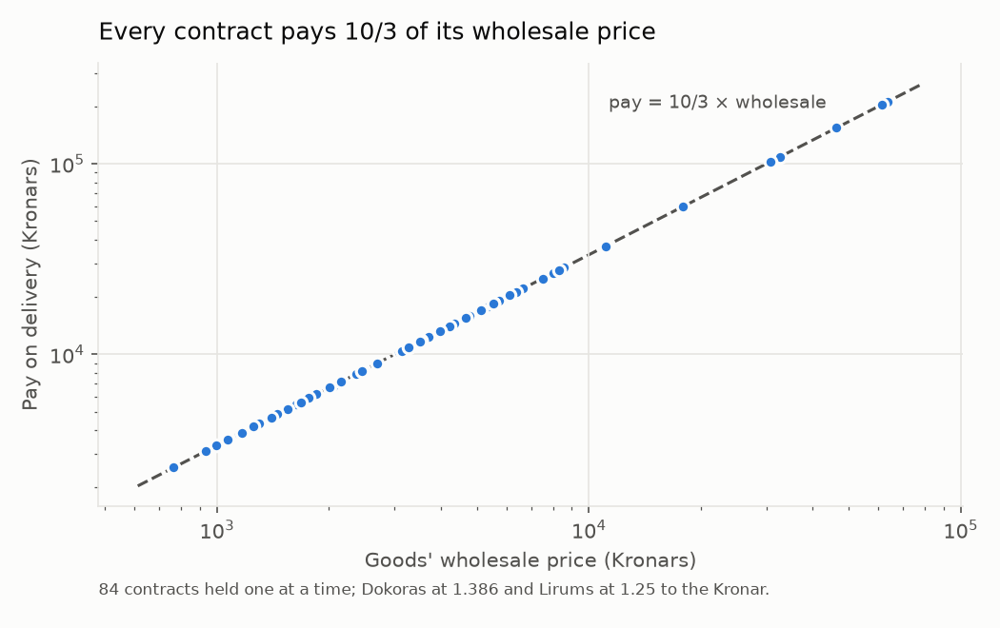
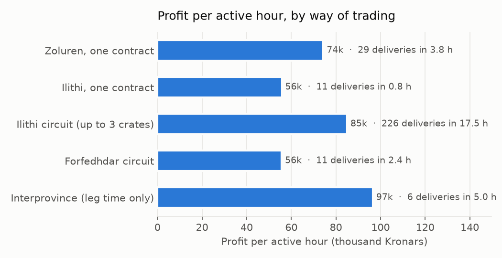

# Caravan contracts

A Trader carries goods between guild outposts in a rented caravan. The issuing town sells the goods at their wholesale price plus dues, and the destination pays ten-thirds of that wholesale price, so every contract clears about twice its wholesale after costs. Holding a crate from every town at once, a circuit, earned the most per hour of the ways measured.

## A contract

- ASK MINISTER FOR CONTRACT takes one within the province; ASK BROKER FOR CONTRACT, one for another province (the Crossing, Shard and Riverhaven have a broker). READ the contract to see the goods, the destination and its worth; the text goes to the familiar window.
- The town charges the goods' wholesale price plus dues, about a quarter of the wholesale (a third for another province), paid at its shipment clerk; the clerk adds a transport fee of 36 to 50.
- The destination's clerk pays the contract's worth: always 10/3 of the wholesale, in the destination's coin (1.386 Dokoras or 1.25 Lirums to the Kronar).
- Profit is about 2.05 times the wholesale: a 4,500-Kronar crate costs about 5,800 with dues and clears about 9,200.
- One contract per issuing town at a time; several crates for different towns ride together.

## The caravan

- RENT CARAVAN at an outpost's clerk: 400 Kronars, 288 Dokoras or 320 Lirums. RETURN CARAVAN gives it back once its storage box is empty.
- Feed it grass before every lead; a feedbag of grass carried along keeps it fed.
- TELL CARAVAN TO LEAD TO <town>: you follow it through any roundtime, so a lead is time to train in place (a song, appraising, magical research).
- It boards the ferries and the Obsidian Pass gondola with you. A ferry charges a flat fare per caravan, whatever it carries: 77 Kronars on Alfren's Ferry (60 once with nothing loaded), 152 Lirums on the Faldesu ferry.

## Time and money

A leg's median time: Ilithi 5 minutes, Zoluren 6½, Forfedhdar 12, Therengia 13 (Riverhaven to Langenfirth goes by way of Therenborough), another province 48. Per active hour, in Kronars:

- A circuit stays in one province: at each stop every crate for that town is handed in and the town's own contract taken, then the caravan leads to the nearest town with business. It earns more per hour than one contract at a time by delivering more often: about 13 crates an hour against 8, crates for several towns riding every leg.
- Interprovince contracts pay the most per hour of leg, but the legs are long and the wait for the next contract is not counted above.
- Forfedhdar's circuit was slower: long legs, Boar Clan reached by way of Hibarnhvidar and Ain Ghazal across a ferry.

## Commodities, for comparison

A Trader can also buy a good at one of the three commodity pits (the Crossing, Arthe Dale, Leth Deriel) and sell it at another: ORDER at the pit clerk for the board price plus a guild cut of 1.5 to 3%, carried on a lent pack animal (drafted up to a two-auroch caravan for a large load), SELL at the buyer's shipment clerk for its board price.

- One evening's boards, 34 goods at each pit: a good often costs a third more at another pit (median spread 34%), but a pit reading Surplus! buys none, and the widest spreads nearly all ended in one. The trades worth carrying were the few with a buyer short of Surplus, 4,000 to 9,000 Kronars clear each.
- The one trade made: 556 bins of charcoal, Arthe Dale to the Crossing, 20,326 paid and 27,244 back, 6,918 clear in 4 minutes. How often the boards offer one like it was not measured.

[trade.md](trade.md) is `;trade`, the script that runs the contracts; [commodities.md](commodities.md) is `;commodities`.
